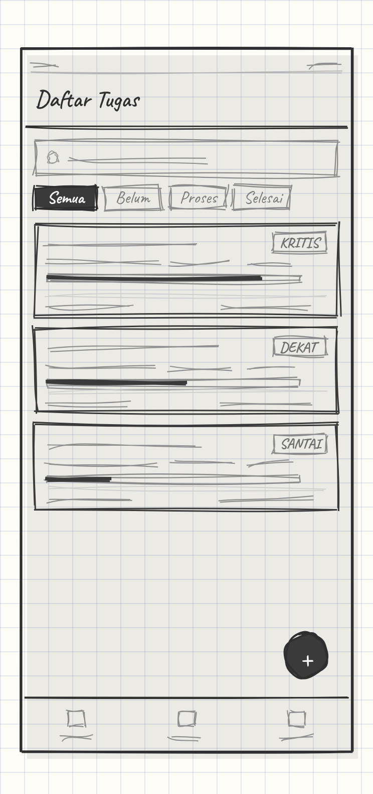
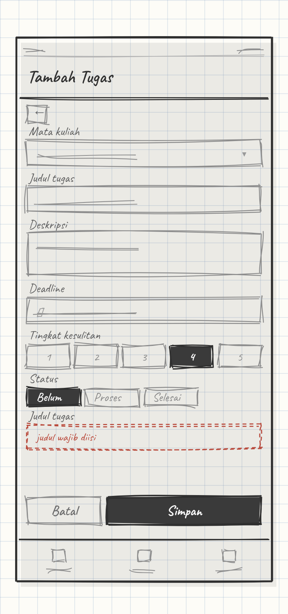
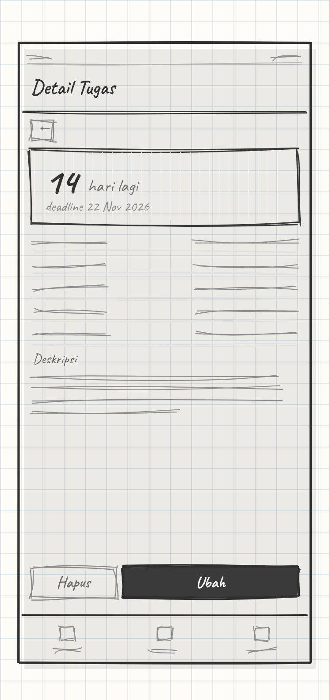
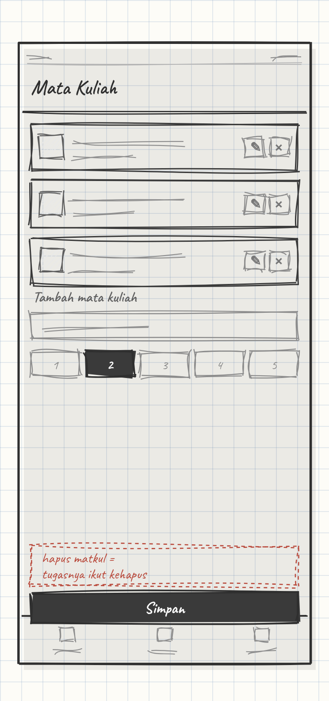

# task-tugas-akhir

Aplikasi mobile Flutter untuk memantau dan memprioritaskan tugas perkuliahan
berdasarkan bobot mata kuliah, tingkat kesulitan, dan sisa waktu menuju deadline.

Dibuat untuk memenuhi **UAS Praktikum Mobile Programming**.

## Latar belakang

Tugas kuliah datang bersamaan dari banyak mata kuliah dengan deadline yang berdekatan.
Daftar tugas biasa (to-do list) hanya menampilkan apa yang harus dikerjakan tanpa memberi
tahu mana yang paling mendesak. Aplikasi ini menghitung skor prioritas setiap tugas
sehingga mahasiswa tahu urutan pengerjaan yang paling masuk akal.

## Rumus prioritas

```
skor = (sks × kesulitan) / sisa_hari
```

Skor dihitung di sisi Flutter (bukan disimpan di database) karena `sisa_hari` berubah
setiap hari. Semakin besar skor, semakin mendesak tugas tersebut.

## Rancangan antarmuka

Wireframe sketsa tangan, 4 halaman, skala 1:1 (360 × 760 dp).
Berkas sumber: [`design/wireframe-kasar.html`](design/wireframe-kasar.html) —
render satu lembar dengan `design/wireframe-kasar@2x.png`.

<table>
<tr>
<td width="300" valign="top"></td>
<td valign="top">

**1. Daftar Tugas** — `/`

Halaman utama yang langsung menjawab pertanyaan "kerjain yang mana dulu?".

- Kolom cari menyaring judul dan deskripsi tugas.
- Chip filter memilih status: semua, belum, proses, selesai.
- Kartu tugas diurutkan menurun berdasarkan skor prioritas, bukan tanggal.
- Tiap kartu memuat nama mata kuliah, bobot SKS, sisa hari, tingkat kesulitan,
  serta badge urgensi: **KRITIS**, **DEKAT**, atau **SANTAI**.
- Bar tipis di bawah judul menunjukkan besaran skor secara visual.
- Tombol `+` membuka form tambah tugas.
- Navigasi bawah berpindah antara Tugas, Mata Kuliah, dan Profil.

Data: `GET /tugas` (mendukung `?q=` dan `?status=`).

</td>
</tr>

<tr>
<td width="300" valign="top"></td>
<td valign="top">

**2. Tambah / Ubah Tugas** — `/form`

Satu halaman dipakai untuk dua keperluan: menambah tugas baru dan mengubah tugas lama.

- Mata kuliah dipilih dari daftar yang sudah ada, tidak diketik bebas,
  supaya bobot SKS-nya pasti ikut terbaca.
- Judul wajib diisi, deskripsi opsional.
- Deadline diambil lewat pemilih tanggal sehingga formatnya seragam.
- Tingkat kesulitan memakai tombol 1–5, bukan kolom teks, agar nilai di luar
  rentang tidak mungkin masuk.
- Status dipilih lewat chip.
- Setiap kolom punya pesan kesalahan sendiri di bawahnya. Contoh pada gambar
  adalah keadaan ketika judul dikosongkan.

Data: `POST /tugas` untuk data baru, `PUT /tugas/:id` untuk perubahan.

</td>
</tr>

<tr>
<td width="300" valign="top"></td>
<td valign="top">

**3. Detail Tugas** — `/detail`

Dibuka dengan menekan salah satu kartu di halaman daftar.

- Angka besar di atas adalah sisa hari menuju deadline, dihitung ulang setiap
  halaman dibuka.
- Tabel informasi memuat mata kuliah, bobot SKS, kesulitan, skor prioritas
  beserta kategorinya, dan status terkini.
- Deskripsi ditampilkan penuh.
- Status bisa diganti langsung dari sini tanpa membuka form.
- Tombol hapus meminta konfirmasi lebih dulu, karena tindakan ini tidak bisa
  dibatalkan.

Data: `GET /tugas/:id` untuk isi halaman, `PUT /tugas/:id/status` untuk ganti
status cepat, `DELETE /tugas/:id` untuk hapus.

</td>
</tr>

<tr>
<td width="300" valign="top"></td>
<td valign="top">

**4. Mata Kuliah** — `/mata-kuliah`

Halaman pendukung. Bobot SKS yang diisi di sini adalah salah satu pembilang pada
rumus prioritas, jadi data mata kuliah harus benar lebih dulu.

- Daftar mata kuliah beserta jumlah tugas yang menempel padanya.
- Tiap baris bisa diubah atau dihapus.
- Form tambah berisi nama dan bobot SKS 1–6.
- Menghapus mata kuliah ikut menghapus seluruh tugas di dalamnya
  (`ON DELETE CASCADE`), karena itu ada peringatan sebelum tombol simpan.

Data: `GET` / `POST` / `PUT` / `DELETE /mata-kuliah`.

</td>
</tr>
</table>

## Alur halaman

```
Daftar Tugas ──tap kartu──> Detail Tugas ──tombol ubah──> Form (mode edit)
     │                                                          ▲
     └──tombol +──> Form (mode tambah) ─────────────────────────┘
     │
     └──navigasi bawah──> Mata Kuliah
```

Navigasi memakai named route, dan halaman Detail menerima `id` tugas lewat
`arguments` — sesuai pola Modul 08.

## Pemetaan ke modul praktikum

Struktur kode mengikuti pola yang dipakai modul, bukan pola baru. Bagian yang sengaja
dibuat berbeda hanya sumber data (API dan database), karena modul masih memakai
JSONPlaceholder dan API publik yang bersifat baca saja.

| Ketentuan UAS | Modul acuan | Implementasi |
| --- | --- | --- |
| UI (Row, Column, Card, TextField) | 03, 04, 05 | `Row`, `Column`, `Flexible`/`Expanded`, `SizedBox`, `Spacer`, `Card` |
| Daftar data | 06 | `ListView.builder` + kartu tugas |
| Navigasi minimal 3 halaman | 07, 08 | Named route + `arguments` saat ke halaman detail |
| Model & JSON | 10, 13 | Model class + `fromJson()` / `toJson()` |
| REST API | 10, 13 | package `http`, `GET`/`POST`/`PUT`/`DELETE` |
| Asynchronous | 13 | `Future`, `async`, `await` + loading/error state |
| State management | 11 | `GetX` — `GetxController`, `.obs`, `Obx`, `GetMaterialApp` |
| Form & validasi | 13 | `TextField`/`Form`, pesan kesalahan, `SnackBar` notifikasi |
| Fitur tambahan | 06, 09, 10 | Pencarian, filter status, sorting prioritas |

## Struktur proyek

Mengikuti pembagian `model` / `view` / `viewmodel` seperti pada Modul 10 dan 11.

```
lib/
├── main.dart                  // GetMaterialApp, tema, daftar named route
├── model/
│   ├── mata_kuliah.dart       // model + fromJson/toJson
│   └── tugas.dart             // model + fromJson/toJson + getter skorPrioritas
├── view/
│   ├── home.dart              // daftar tugas + pencarian + filter
│   ├── form_tugas.dart        // form tambah/edit + validasi
│   ├── detail_tugas.dart      // detail + countdown
│   └── daftar_matakuliah.dart // CRUD mata kuliah
└── viewmodel/
    ├── tugas_controller.dart  // GetX controller + pemanggilan HTTP
    └── matakuliah_controller.dart
```

Pemanggilan API diletakkan di dalam `viewmodel` seperti pada Modul 10 dan 13, sehingga
`view` hanya mengurus tampilan.

## Teknologi

- Flutter (Dart)
- GetX — state management dan routing
- package `http` — HTTP client
- package `intl` — format tanggal deadline
- Backend: REST API sendiri (Node.js + PostgreSQL), bukan JSONPlaceholder

## Menjalankan

```bash
flutter pub get
flutter run
```

Alamat API diletakkan pada `lib/config.dart` (tidak di-commit).

## Status

Dalam pengerjaan — UAS Praktikum Mobile Programming.
